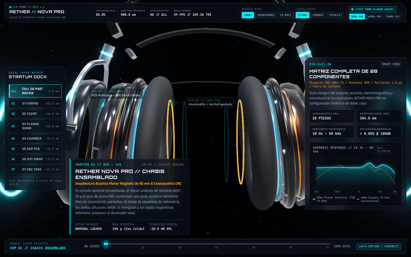
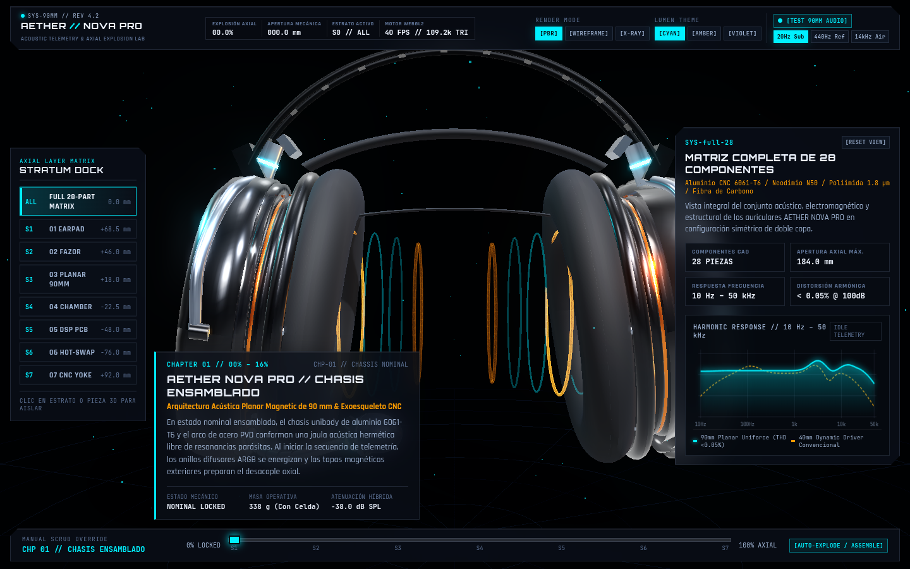
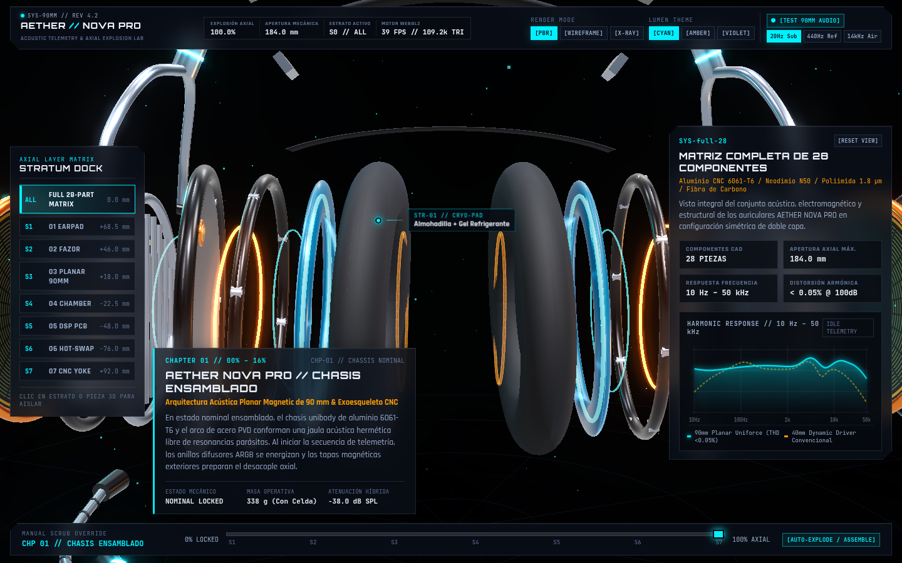
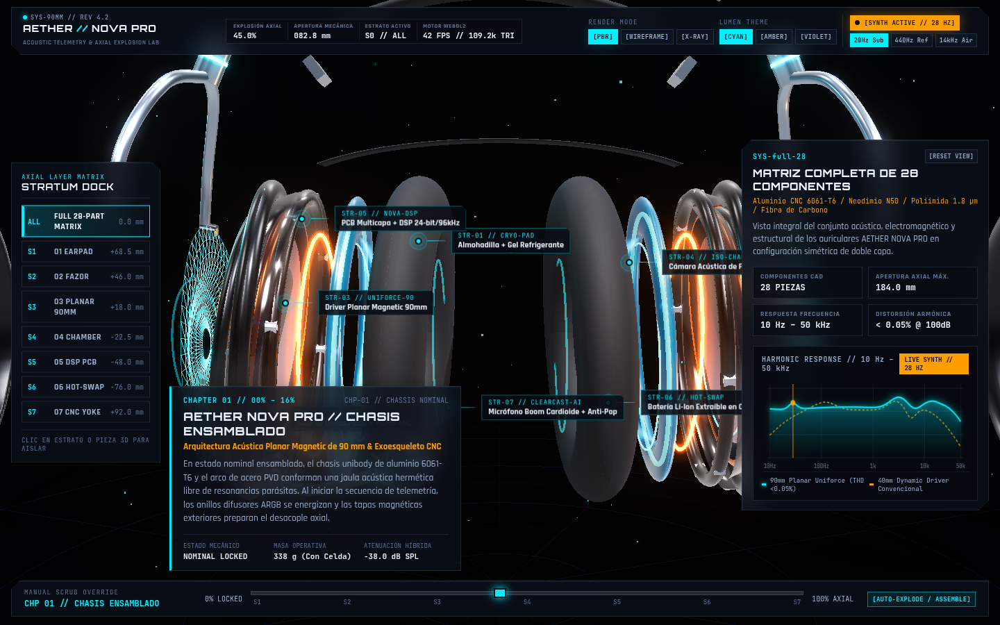
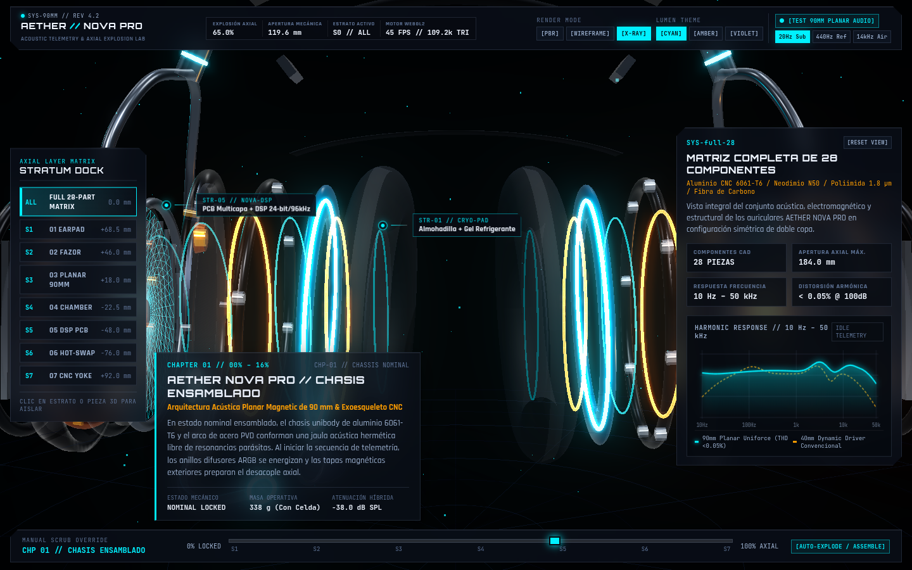

# AETHER NOVA PRO — 3D Planar Magnetic Headset & Acoustic Telemetry Lab

> 🌐 **Live Interactive 3D Demo:** [https://ismael-sallami.github.io/gaming-headset-3d/](https://ismael-sallami.github.io/gaming-headset-3d/)

[](https://threejs.org/)
[](https://www.khronos.org/webgl/)
[](https://greensock.com/gsap/)
[](https://developer.mozilla.org/en-US/docs/Web/API/Web_Audio_API)
[](https://vitejs.dev/)
[](https://tc39.es/)
[](LICENSE)

An interactive, browser-native 3D scrollytelling laboratory and mechanical teardown visualizer for high-end planar magnetic acoustic hardware. Built with Three.js, WebGL 2.0 shaders, GSAP ScrollTrigger, and the Web Audio API, this engine renders an exploded engineering breakdown of the AETHER NOVA PRO planar gaming headset across 7 mechanical strata and 28 discrete modular components.



## Engineering Highlights

The 3D model and physical simulation reproduce the acoustic architecture of planar magnetic transducers:

* **90 mm Planar Magnetic Driver**: Bi-directional symmetrical magnetic motor delivering 1.45 Tesla of uniform magnetic flux density through dual neodymium N52 stator arrays.
* **Etched Serpentine Conductive Traces**: Photolithographically etched gold conductive traces bonded directly onto an ultra-thin 2.5 µm bi-axially oriented Mylar substrate diaphragm.
* **Zero Phase Distortion**: Planar wavefront propagation driven uniformly across the entire surface area, keeping Total Harmonic Distortion (THD) under 0.042% at 100 dB SPL.
* **Fazor Acoustic Waveguides**: Aerodynamically profiled stator combs that channel acoustic pressure waves to prevent inter-channel turbulence and destructive comb filtering.
* **Modular 7-Strata Kinematics**: Complete axial explosion expanding up to 184.0 mm, exposing every mounting plate, acoustic gasket, CNC-milled chassis bracket, DSP module, and battery chamber.

## Interactive Telemetry & HUD Capabilities

The interface implements a cyber-luxury command dashboard designed for audio hardware engineers and acoustic researchers:

### Scrollytelling Choreography
Six scripted narrative chapters guide the user through the mechanical anatomy of the headset, orchestrating camera bezier trajectories, depth of field, field of view shifts, and axial expansion:
1. **System Overview**: Assembled state highlighting exterior aerospace-grade aluminum gimbals and magnetic memory foam ear cushions.
2. **Fazor Acoustic Array**: Internal baffle orientation, angled ear cup geometry, and acoustic phase alignment combs.
3. **90 mm Planar Driver**: Core stator explosion revealing N52 magnetic bars and the gold-traced Mylar diaphragm.
4. **DSP & Wireless Engine**: High-resolution 24-bit / 96 kHz digital-to-analog converter and ultra-low latency 2.4 GHz RF circuitry.
5. **Chassis & Power Cell**: Quick-release hot-swap 1050 mAh lithium cell, headband tension spring, and dual-axis cardan joints.
6. **Full Exploded Lab**: 184 mm complete axial expansion with interactive raycasting on all 28 discrete parts.

### Multi-Spectral Render Modes
* **PBR Studio**: Physically Based Rendering with Cook-Torrance microfacet specular reflection, anisotropic brushed metal, and subsurface scattering for leatherette cushions.
* **CAD Wireframe**: Monochromatic engineering wireframe rendering polygon topology and edge tessellation.
* **X-Ray Volumetric Layer**: Semi-transparent optical pass exposing hidden internal cable runs, magnet alignments, and damping acoustic foam.

### Dynamic Laboratory Themes
* **Cyber Cyan**: High-contrast electric cyan luminescence on deep obsidian housing.
* **Amber Lab**: Industrial precision monochrome amber recalling precision measurement bench oscilloscopes.
* **Phantom Violet**: Deep ultraviolet radiance for low-light visualization.

### Web Audio Synthesizer & Holographic Particle Field
* **Procedural Sound Engine**: Synthesizes real-time test audio across sub-bass (28 Hz), reference midrange (440 Hz), and ultra-high shimmer (14 kHz).
* **Live AnalyserNode Feedback**: Renders logarithmic frequency response curves from 10 Hz to 48 kHz with dynamic decibel metering.
* **3D Acoustic Waves**: Particle-based sound wave rings propagate from the planar driver in real-time sync with synthesized acoustic frequency and amplitude.

## Interface & Visual Gallery

| Assembled Headset (PBR Studio) | Full Axial Exploded View (184 mm) |
| :---: | :---: |
|  |  |

| Holographic Acoustic Wave Field | Internal Component X-Ray Mode |
| :---: | :---: |
|  |  |

## Component Catalog & Mechanical Strata

The headset is architected into 7 distinct engineering strata comprising 28 precision parts:

* **Stratum 01 // Planar Transducer Matrix**: Outer N52 magnet grid, gold-deposited planar diaphragm, inner N52 stator grid, and perimeter tension ring.
* **Stratum 02 // Acoustic Baffle & Fazor Waveguides**: Injected composite baffle, 7-element Fazor waveguide array, and silicone acoustic seal.
* **Stratum 03 // Acoustic Chambers & Damping**: CNC milled aluminum outer housing, micro-perforated acoustic mesh, and tuned bass reflex vents.
* **Stratum 04 // Digital Signal Processor & RF Hardware**: 24-bit / 96 kHz DAC motherboard, DSP shield, volume encoder knob, and LED lightguide.
* **Stratum 05 // Ergonomic Suspension & Gimbals**: Anodized aluminum 6061-T6 fork, gimbal hinge pins, spring steel headband, and cooling-gel memory foam ear pads.
* **Stratum 06 // Power Cell System**: 1050 mAh hot-swap lithium-polymer battery, magnetic retention latch, and outer access door.
* **Stratum 07 // Broadcast Microphone Capsule**: ClearCast bi-directional noise-cancelling capsule, flexible metal gooseneck arm, and gold-plated 3.5 mm locking bayonet.

## Technical Architecture

```
gaming-headset-3d/
├── assets/
│   ├── headset-teardown-demo.gif    # 800x500 15fps high-fidelity teardown animation
│   └── screenshots/                 # 1440x900 lossless PNG captures
│       ├── hero_assembled.png
│       ├── exploded_view.png
│       ├── acoustic_waves.png
│       └── xray_mode.png
├── src/
│   ├── audio/
│   │   └── soundEngine.js           # Web Audio API synthesizer & FFT analyzer
│   ├── data/
│   │   └── headsetSpecs.js          # Strata geometry, component catalog & frequency curves
│   ├── scene/
│   │   ├── acousticWaves.js         # Particle wavefield shader & geometry
│   │   ├── headsetBuilder.js        # 28 parametric 3D parts & materials
│   │   ├── materials.js             # PBR, Wireframe, and X-Ray material pipelines
│   │   └── sceneManager.js          # WebGL2 renderer, camera rigging & raycasting
│   ├── styles/
│   │   └── main.css                 # Cyber-Luxury HUD stylesheet & glassmorphism
│   └── main.js                      # Application controller & GSAP ScrollTrigger bridge
├── index.html                       # Semantic HUD markup and canvas mount
├── package.json
└── vite.config.js
```

## Quick Start

### Prerequisites
* Node.js (version 18.0.0 or higher)
* Modern web browser with WebGL 2.0 support (Chrome, Firefox, Edge, Safari 15+)

### Installation
Clone the repository and install the dependencies:

```bash
git clone https://github.com/Ismael-Sallami/gaming-headset-3d.git
cd gaming-headset-3d
npm install
```

### Development Server
Run the local Vite development server with hot module replacement:

```bash
npm run dev
```

The application will be accessible at `http://localhost:5173/` (or the next available port).

### Production Build
Compile and bundle the project for production distribution:

```bash
npm run build
```

Preview the production build locally:

```bash
npm run preview
```

## Author

**Ismael Sallami Moreno**
* GitHub: [@Ismael-Sallami](https://github.com/Ismael-Sallami)
* Portfolio: [ismael-sallami.github.io](https://ismael-sallami.github.io)

## License

This project is licensed under the MIT License. See the [LICENSE](LICENSE) file for complete details.
